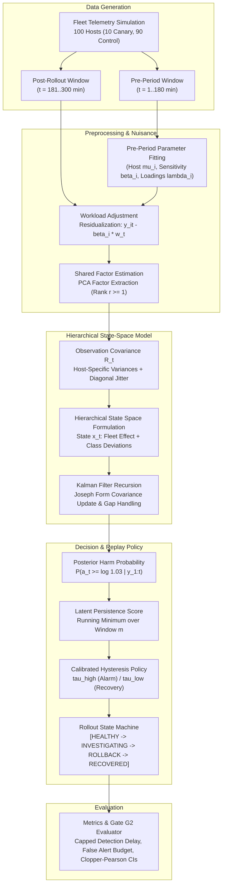
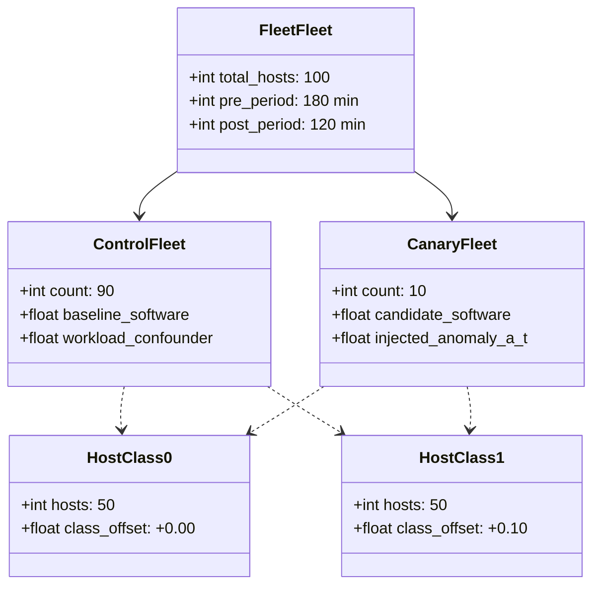
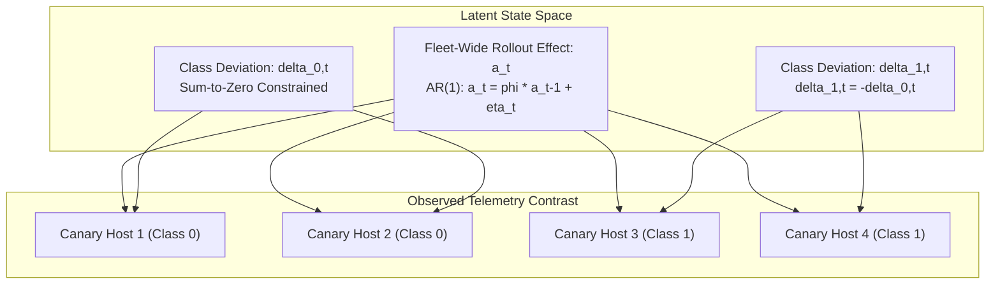

# System Architecture: Canary SSM V3
## Hierarchical, Inertia-Constrained State-Space Models for Safer Software Rollout Decisions

- **Architecture Level:** Full Pipeline (Telemetry Generation $\to$ Estimation $\to$ Filtering $\to$ Calibration $\to$ Decision $\to$ Evaluation)
- **Module Root:** `canary_ssm/`

---

### 1. End-to-End Pipeline Overview

The Canary SSM V3 monitoring pipeline continuously processes telemetry streams from canary and control fleets, estimates latent degradation states online, and executes calibrated advisory rollback decisions.

---

### 2. Fleet & Host Hierarchy Structure

In production software delivery, a deployment fleet is partitioned into distinct hardware tiers, data centers, or failure domains:

- **Total Fleet:** $N = 100$ hosts.
- **Canary Partition:** $N_C = 10$ canary hosts receiving the candidate software build at $t_{\text{rollout}} = 180$.
- **Control Partition:** $N_0 = 90$ baseline hosts serving identical traffic on the stable version.
- **Host Classes:** 2 distinct machine classes (e.g., memory tiers or architecture profiles) with class-specific baseline latency offsets ($\mu_c$) and workload response characteristics.

---

### 3. Pipeline Stages in Detail

#### Stage 1: Pre-Period Nuisance Estimation (`canary_ssm/preprocess.py`)
To prevent future data leakage (Rule 3), all host-specific nuisance parameters are fitted strictly on pre-period data ($t \le 180$):
$$\log y_{it} = \mu_i + \beta_i w_t + \lambda_i f_t + \epsilon_{it}$$
- $\mu_i$: Host-specific baseline response.
- $\beta_i$: Host sensitivity to fleet-wide workload $w_t$.
- $f_t, \lambda_i$: Latent environmental factor and host factor loadings.

#### Stage 2: Workload Adjustment & Contrast (`canary_ssm/factor.py`)
During the rollout monitoring window ($t > 180$), observed latency is dynamically residualized:
$$\tilde{y}_{it} = y_{it} - \hat{\mu}_i - \hat{\beta}_i w_t$$
The fleet contrast is formed by comparing residualized canary observations against the contemporaneous control baseline.

#### Stage 3: Hierarchical State-Space Representation (`canary_ssm/hierarchy.py`)
The rollout effect is modeled as a hierarchical latent Gaussian state vector:
$$\mathbf{x}_t = \begin{bmatrix} a_t^{\text{fleet}} \\ \boldsymbol{\delta}_t^{\text{class}} \end{bmatrix}$$
- **Fleet Level ($a_t^{\text{fleet}}$):** Common rollout effect experienced across all canary instances. Follows an autoregressive process $a_{t+1} = \phi a_t + \eta_t$.
- **Class Level ($\boldsymbol{\delta}_t^{\text{class}}$):** Class-specific deviations constrained to sum to zero ($\sum_c \delta_{c,t} = 0$) ensuring mathematical parameter identifiability.
- **Host Level:** Residual unshared host noise captured by observation covariance matrix $\mathbf{R}_t$.

#### Stage 4: Robust Kalman Filtering (`canary_ssm/kalman.py`)
State updates are computed recursively using the stabilized Joseph-form covariance update:
$$\mathbf{K}_t = \mathbf{P}_{t|t-1} \mathbf{H}_t^T \left(\mathbf{H}_t \mathbf{P}_{t|t-1} \mathbf{H}_t^T + \mathbf{R}_t\right)^{-1}$$
$$\hat{\mathbf{x}}_{t|t} = \hat{\mathbf{x}}_{t|t-1} + \mathbf{K}_t \left(\mathbf{y}_t - \mathbf{H}_t \hat{\mathbf{x}}_{t|t-1}\right)$$
$$\mathbf{P}_{t|t} = (\mathbf{I} - \mathbf{K}_t \mathbf{H}_t) \mathbf{P}_{t|t-1} (\mathbf{I} - \mathbf{K}_t \mathbf{H}_t)^T + \mathbf{K}_t \mathbf{R}_t \mathbf{K}_t^T$$
The Joseph formulation guarantees positive semi-definiteness even under extreme observation gaps or long telemetry missingness bursts.

#### Stage 5: Posterior Harm Probability & Persistence (`canary_ssm/inertia.py`)
Given state mean $\hat{a}_{t|t}$ and variance $\sigma_{a,t}^2$, the instantaneous probability that the deployment degrades latency beyond the 3.0% threshold ($a^* = \log 1.03$) is:
$$p_t = P(a_t \ge a^* \mid y_{1:t}) = 1 - \Phi\left(\frac{a^* - \hat{a}_{t|t}}{\sigma_{a,t}}\right)$$
To prevent spurious triggering on isolated transient noise, the persistence score tracks the running minimum over a rolling window $m$:
$$S_t^{(m)} = \min_{j \in \{0, \dots, m-1\}} p_{t-j}$$

#### Stage 6: Replay Decision Policy (`canary_ssm/decision.py`)
The decision policy maintains an automated state machine:
- **Alarm Transition:** Triggered when $S_t^{(m)} \ge \tau_{\text{high}}$ for $k$ consecutive steps $\implies$ Canary halted / rolled back.
- **Recovery Transition:** Following an alarm, if metric recovery occurs ($S_t \le \tau_{\text{low}}$ for $n_{\text{clear}} = 5$ consecutive steps) $\implies$ Canary resumed.
- **Threshold Calibration:** $\tau_{\text{high}}$ is calibrated on $B = 2,000$ exchangeable null rollouts via order statistics to enforce an exact 5% false-alert budget.

---

### 4. Evaluator Isolation & Data Roles

In strict compliance with Part 0 Rules:
- Detector code (`factor.py`, `hierarchy.py`, `kalman.py`, `decision.py`) has **zero access** to simulation truth matrices or evaluator metrics.
- Only evaluator modules (`metrics.py`, `experiments.py`) inspect `data/*_truth/` files to calculate detection delays, premature alarms, and horizon-capped outcomes.
